<div align="center">

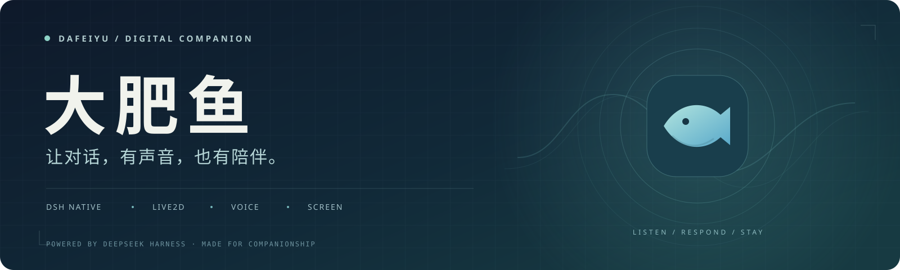

# 大肥鱼 · DSH 数字人语音伙伴

**让你的 DeepSeek Harness，不只会打字。**

实时语音 · Live2D 表情与动作 · 屏幕陪伴 · 主动搭话

<p>
  <a href="https://github.com/rikey123/dafeiyu-dsh-live2d/releases/latest"></a>
  <a href="https://github.com/rikey123/dafeiyu-dsh-live2d/actions/workflows/release.yml"></a>
  <a href="https://github.com/rikey123/dafeiyu-dsh-live2d/stargazers"></a>
</p>
<p>
  
  =22" />
  
  
</p>

[**下载安装**](https://github.com/rikey123/dafeiyu-dsh-live2d/releases/latest) · [**界面预览**](#screenshots) · [**功能亮点**](#features) · [**快速开始**](#quick-start) · [**文档**](#documentation) · [**反馈问题**](https://github.com/rikey123/dafeiyu-dsh-live2d/issues)

</div>

---

大肥鱼是一个可以独立安装的 **DSH 语音与 Live2D 插件**。你可以和她说话、切换音色与主题，让她在你分享的画面里寻找值得聊的小事；也可以配置兴趣，让安静的间隙多一点陪伴。

**模型调用、工具执行、子智能体、会话、人格与记忆交给 DSH；大肥鱼专注数字人、语音和屏幕交互。** 不另起一套 Agent 或记忆系统，也不修改 DSH 安装源码。

<a name="screenshots"></a>

## 🖼️ 看见大肥鱼

<p align="center">
  <a href="docs/media/digital-life.webp">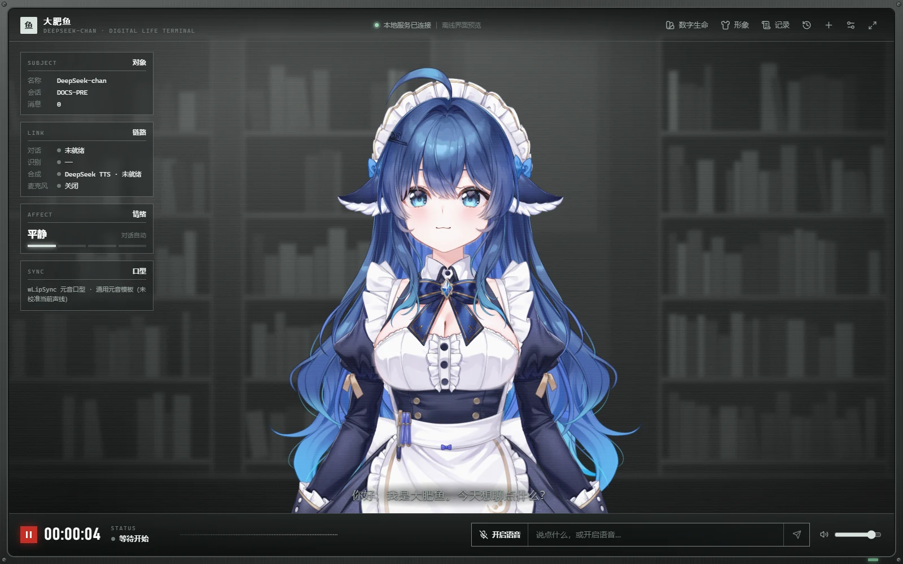</a>
  <br />
  <sub><b>数字生命 · Digital Life Terminal</b> — 保留完整的舞台、仪表与输入框设计。</sub>
</p>

> 截图来自 v0.3.0 原版前端的**离线界面预览**，使用示例配置，不是云端模型、ASR 或 TTS 已就绪的证明。截图中的角色仅作效果展示，不随源码或安装包分发。原画及拆分：**神宫凉子**；Live2D 建模：**霓虹猫_NeonNeko**。[素材说明](docs/media/README.md)

<p align="center"><sub>点击任意截图可查看大图。</sub></p>

<table>
  <tr>
    <td width="50%" align="center">
      <a href="docs/media/neon-companion.webp">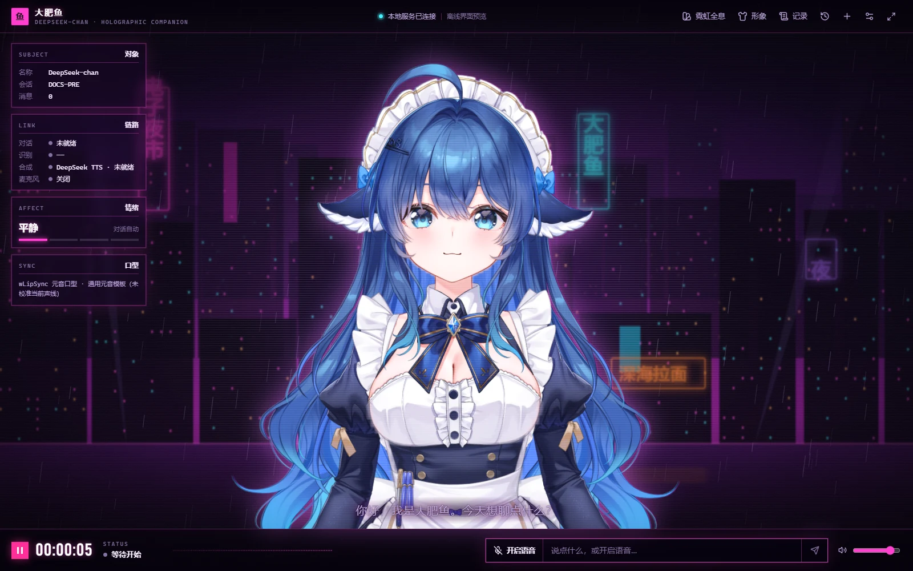</a><br />
      <b>🌃 霓虹全息</b><br /><sub>一键切换另一种陪伴氛围。</sub>
    </td>
    <td width="50%" align="center">
      <a href="docs/media/avatar-wardrobe.webp">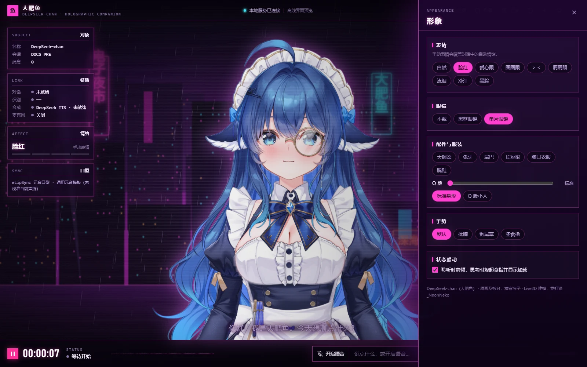</a><br />
      <b>🎭 表情、手势与装扮</b><br /><sub>手动选表情，也可以让状态带动角色。</sub>
    </td>
  </tr>
  <tr>
    <td align="center">
      <a href="docs/media/tts-api.webp">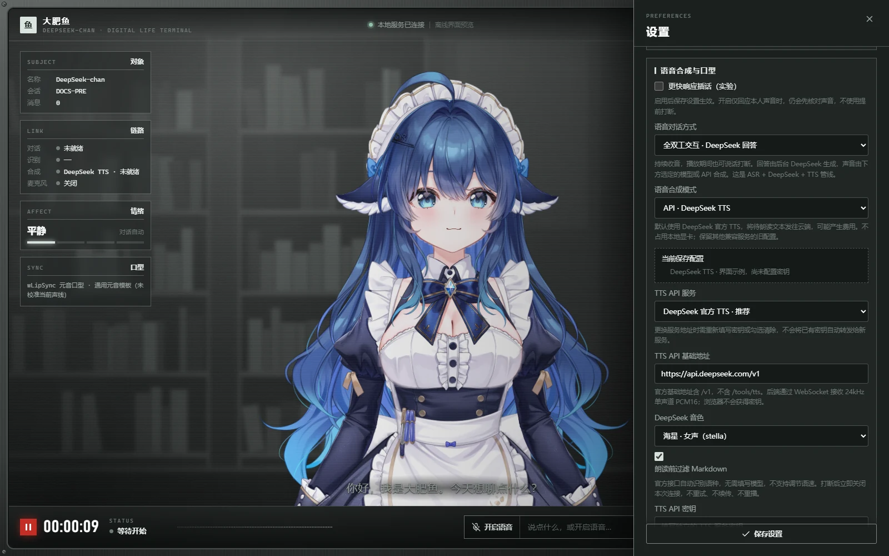</a><br />
      <b>☁️ API 声音</b><br /><sub>DeepSeek 官方 TTS 与兼容 API，音色按服务选择。</sub>
    </td>
    <td align="center">
      <a href="docs/media/local-tts.webp">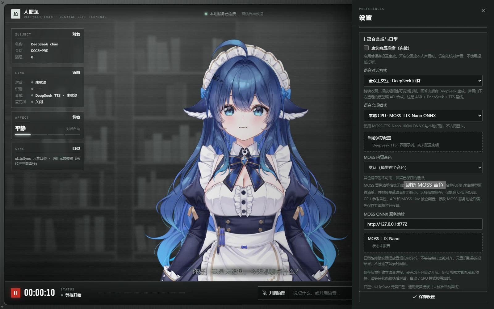</a><br />
      <b>🧩 本地 CPU 语音</b><br /><sub>MOSS-TTS-Nano ONNX，不占用显卡。</sub>
    </td>
  </tr>
  <tr>
    <td align="center">
      <a href="docs/media/gpu-tts.webp">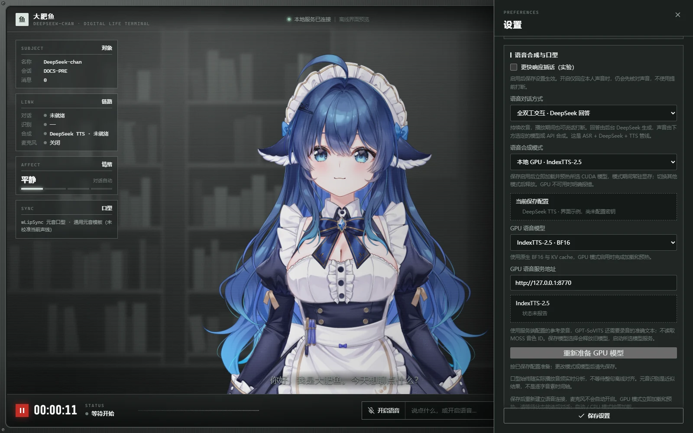</a><br />
      <b>⚡ 本地 GPU 语音</b><br /><sub>GPU 模式启用时加载与预热，而非等首次合成。</sub>
    </td>
    <td align="center">
      <a href="docs/media/interests-and-presence.webp">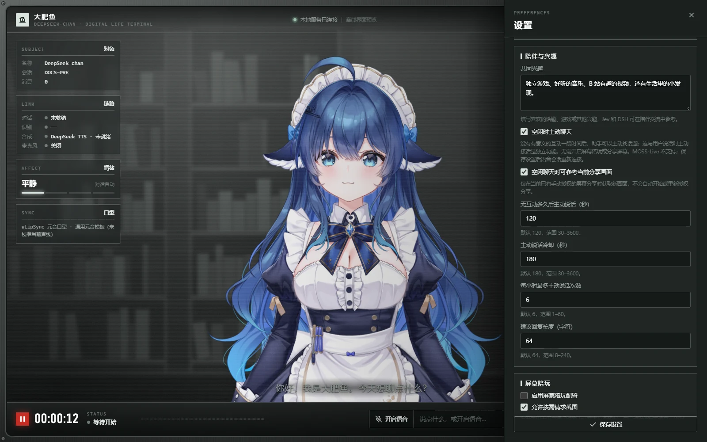</a><br />
      <b>💬 有兴趣，也会找话题</b><br /><sub>共同兴趣、空闲搭话、冷却与频率都能调整。</sub>
    </td>
  </tr>
  <tr>
    <td align="center">
      <a href="docs/media/screen-companion.webp">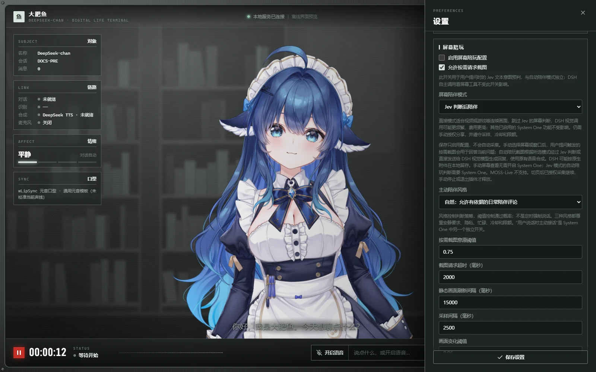</a><br />
      <b>👀 先判断，再评论</b><br /><sub>System One 结合画面、人格与兴趣判断交流机会。</sub>
    </td>
    <td align="center">
      <a href="docs/media/direct-screen.webp">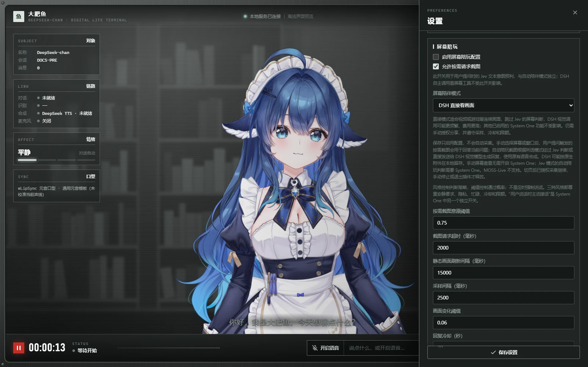</a><br />
      <b>🎮 连续画面，直接陪伴</b><br /><sub>可跳过屏幕 Jev 预判，由 DSH 决定是否开口。</sub>
    </td>
  </tr>
</table>

<a name="features"></a>

## ✨ 不只是一个会说话的立绘

| | 能力 | 做了什么 |
| :--: | --- | --- |
| 🎙️ | **自然语音交互** | 本地 ASR、VAD、流式识别预览、播放期间说话与打断；可选本人声纹筛选。 |
| 🔊 | **声音按场景切换** | 本地 GPU、本地 CPU、DeepSeek / 兼容 TTS API；MOSS-Live 可选语音全双工模式。 |
| 🎭 | **说话不只动嘴** | 播放音频驱动实时近似元音口型，结合情绪、表情、手势与自然待机动作。 |
| 🖥️ | **一起看，而不是只复述** | 屏幕陪玩、对当前内容的主动评论，以及提供给 DSH 的按需看屏幕工具。 |
| 🫧 | **主动，但可调节** | 用户说话时接话、安静后搭话与屏幕评论是独立场景；兴趣、意愿阈值、冷却和频率可配置。 |
| 🧠 | **DSH 还是那个 DSH** | 使用宿主的工具、异步子任务、会话级输出与富内容聊天，保留本项目视觉外壳。 |
| 🐟 | **人格有来处** | 可选完整「蓝色大肥鱼」人设，保留上游署名与许可证，不自动覆盖已有 DSH 人格。 |
| 🪟 | **切页不丢陪伴** | ShadowRoot 嵌入，无 iframe；保留应用实例与已授权交互，隐藏时暂停视觉动画。 |
| 📦 | **安装不再手工拼环境** | 首次运行向导、远端自动准备依赖、官方源 / 中国镜像、进度、重试与独立资源目录。 |

### 两种屏幕陪伴，一套语音体验

| 模式 | 路径 | 适合 |
| --- | --- | --- |
| **Jev 判断后陪伴** | 分享画面 → System One 判断 → 值得开口时交给 DSH → 原语音链路 | 日常桌面陪伴，希望减少主模型看图次数。 |
| **直接交给 DSH** | 分享画面 → DSH 视觉模型自行决定是否回复 → 原语音链路 | 一起看视频、打游戏等连续场景；可能更频繁调用视觉模型。 |

手动开始分享后才有画面输入；切换面板不等于停止分享。**停止分享或退出插件才释放采集。** 按需看屏幕与空闲聊天可以独立配置；画面直送不意味着关闭其他 System One 功能。

### 语音模式一览

| 模式 | 实现 / 服务 | 使用前需要 |
| --- | --- | --- |
| **本地 GPU** | IndexTTS-2.5、GPT-SoVITS v5 turbo | 支持的 CUDA 环境、对应模型与参考音色。GPU 不可用会明确报错。 |
| **本地 CPU** | MOSS-TTS-Nano 100M ONNX | 对应模型资源，无需显卡。 |
| **TTS API** | DeepSeek 官方 TTS、兼容 API | 服务密钥、可用音色及余额；可能产生费用。 |
| **MOSS-Live** | 可选云端全双工语音 | 独立服务与密钥；仅语音，有独立兼容边界。 |

这些是保留的实现能力，**不表示新安装后全部即刻可用**，也不承诺未经测量的实时延迟。详见[语音模式](docs/TTS_MODES.md)与[功能边界](docs/DSH_FEATURE_PARITY.md)。

<a name="quick-start"></a>

## 🚀 从安装到第一次相遇

**目标环境：Windows x64 · Node.js ≥22 · DSH 0.2.2-rc.1**

### 1 · 下载并添加插件

从 [Releases](https://github.com/rikey123/dafeiyu-dsh-live2d/releases/latest) 下载 `dafeiyu-dsh-live2d-0.3.1.tgz`，按实际下载位置执行：

```powershell
dsh plugin --profile web add "E:/Downloads/dafeiyu-dsh-live2d-0.3.1.tgz"
```

### 2 · 打开大肥鱼，选一个资源目录

重启目标 DSH profile → 侧栏 **大肥鱼** → 选择例如 `E:/DafeiyuCompanion`。不必先安装 Python 或 uv。

<p align="center">
  <a href="docs/media/first-run-installer.webp">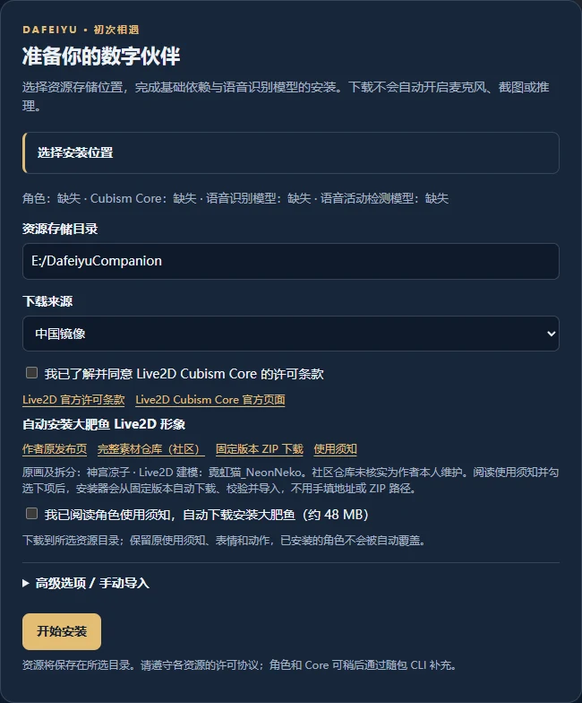</a>
  <br /><sub>首次安装向导 · 资源与你的插件代码分开存放</sub>
</p>

安装器自动准备经校验的 uv、Python 3.12、两套隔离依赖与基础 ASR / VAD 模型。支持显示进度与失败重试，TTS 和声纹模型按需勾选。目录由 DSH 插件存储记住，下次无需重复设置。

### 3 · 导入形象，选择声音

#### 🐟 大肥鱼 Live2D 素材，直接从这里获取

| 入口 | 用途 |
| --- | --- |
| **[作者原发布页 · 神宫凉子](https://www.bilibili.com/video/BV1KmxY66EZ3/)** | 作者的视频简介提供工房 / 群公告获取方式；[作者主页](https://space.bilibili.com/13737731)。 |
| **[完整素材仓库 · YJackie-Li/DeepSeek-chan](https://github.com/YJackie-Li/DeepSeek-chan)** | 包含模型、贴图、物理、表情和动作；[固定版本 ZIP 直接下载](https://github.com/YJackie-Li/DeepSeek-chan/archive/824e03aa38c18c9eb2a9ee1344e3c8bed6671b1f.zip)，无需 Git。 |
| [素材使用须知](https://github.com/YJackie-Li/DeepSeek-chan/blob/824e03aa38c18c9eb2a9ee1344e3c8bed6671b1f/README.md) | 下载、使用前阅读；公开仓库不等于素材可任意转售或再分发。 |

**下载 ZIP 后不用解压**，在安装向导的「本地角色 ZIP 路径」选择它即可；v0.3.1 同时支持原配布包和上面的 GitHub ZIP，自动注册原有表情、动作并保留使用须知。[详细步骤](docs/DEEPSEEK_SKIN.md)

> 素材仓库为社区公开存放，尚未核实仓库维护者就是模型作者，因此不标作“作者官方仓库”。该仓库的使用须知仍禁止擅自重新上传完整模型：本项目直接引用来源，不复制模型进自己的仓库或 Release；也不静默下载第三方角色。


- **形象**：确认 Cubism Core 官方许可，导入有权使用的角色 ZIP；也支持用户授权的 HTTPS 地址与 SHA-256。
- **声音**：在设置中选择本地 GPU / CPU 或 TTS API，按模式补齐模型或密钥。
- **陪伴**：填写共同兴趣，按需开启屏幕陪玩、空闲搭话与 System One 判断。

下载本身不会触发推理、付费调用、开麦或屏幕采集。角色、Core、权重、用户声线、密钥和聊天数据**不随包发布**。

<details>
<summary><b>命令行安装 / 升级 / 卸载</b></summary>

也可以直接使用插件内 CLI；首次安装无需自己寻找 uv：

```powershell
node <插件目录>/bin/cli.mjs install --home "E:/DafeiyuCompanion" --source china
```

命令行通过 `DAFEIYU_HOME` 或插件配置 `homeDir` 指定同一目录。依赖、模型、缓存、配置与日志都与包代码分离。

完整的资源导入、离线选项、升级和卸载步骤见 [安装手册](docs/DSH_RELEASE.md)。发行文件可对照 Release 中的 `SHA256SUMS` 校验。

</details>

<a name="documentation"></a>

## 🧭 想深入一点？

| 开始使用 | 交互与原理 | 开发与边界 |
| --- | --- | --- |
| [安装 / 升级 / 卸载](docs/DSH_RELEASE.md) | [屏幕与主动陪伴](docs/COMPANION_PRESENCE.md) | [协议约定](docs/PROTOCOL.md) |
| [DSH 原生集成](docs/DSH_PLUGIN.md) | [System One 判断](docs/SYSTEMONE.md) | [功能矩阵](docs/DSH_FEATURE_PARITY.md) |
| [语音与音色模式](docs/TTS_MODES.md) | [实时近似口型](docs/REALTIME_LIPSYNC.md) | [第三方与素材声明](THIRD_PARTY_NOTICES.md) |
| [完整聊天能力](docs/DSH_NATIVE_CONVERSATION.md) | [屏幕工具与请求](docs/SCREEN_COMPANION.md) | [发行验收记录](https://github.com/rikey123/dafeiyu-dsh-live2d/releases/download/v0.3.1/VALIDATION.json) |

<details>
<summary><b>本地开发与构建</b></summary>

```powershell
npm --prefix web ci --no-audit
npm --prefix web test
npm run test:release
npm run test:plugin
npm run release -- --out "E:/DafeiyuReleases/0.3.1"
```

构建保留原前端，按白名单收集发行代码与第三方许可证，输出 `.tgz`、`SHA256SUMS` 和审计报告。GitHub Actions 在 Windows 上执行测试、打包与审计，**只生成 artifact，不自动发布 npm 或公开 Release**。

</details>

## 🤝 致谢与使用说明

- **DeepSeek Harness** 提供模型、Agent、工具、子智能体、原生会话、人格与记忆能力。
- **Live2D / PixiJS / AIRI / wLipSync / Pipecat** 等上游项目提供渲染、动作、口型与语音交互基础；具体来源、改动和许可见[第三方声明](THIRD_PARTY_NOTICES.md)及各模块文档。
- **蓝色大肥鱼人格**来自 `YUsaltyfish/dsh-onebot-qq`，保留完整上游文本、来源与 MIT 许可证。[来源信息](personas/blue-whale/source.json)
- **DeepSeek-chan（大肥鱼）角色**：原画及拆分 **神宫凉子**，Live2D 建模 **霓虹猫_NeonNeko**，来源为神宫凉子免费配布模型。截图展示不构成模型再分发授权；可直接访问[作者原发布页](https://www.bilibili.com/video/BV1KmxY66EZ3/)或[素材仓库](https://github.com/YJackie-Li/DeepSeek-chan)，无需自行搜索。[角色说明](docs/DEEPSEEK_SKIN.md)

应用代码许可证尚待所有者确定，当前为 **`UNLICENSED`**，公开可见不等于已授予开源使用许可。第三方代码、人设、角色与 Cubism Core 分别遵循各自条款。本项目并非 DeepSeek 官方数字人产品。

<div align="center">

**给对话一点声音，给屏幕一点陪伴。**

[下载试试](https://github.com/rikey123/dafeiyu-dsh-live2d/releases/latest) · [报告问题](https://github.com/rikey123/dafeiyu-dsh-live2d/issues) · [看看源码](https://github.com/rikey123/dafeiyu-dsh-live2d)

</div>
